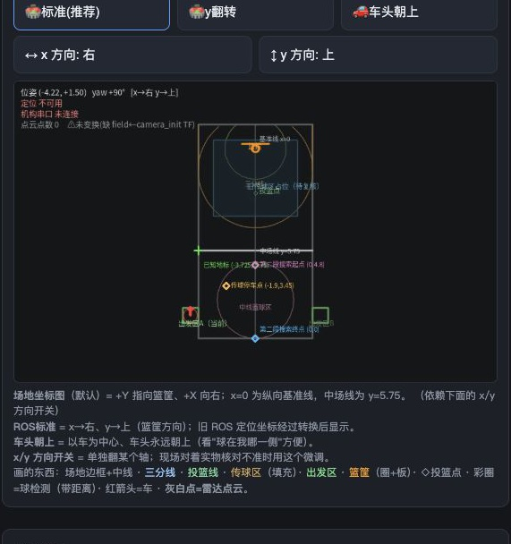

# 场地坐标平移与前端核验

更新日期：2026-10-13。本节取代文档30、31中的旧训练点坐标。

## 当前确认坐标

用户确认从原左下角场地坐标进行平移：`x新=x原−3.725`，`y新=y原`。+Y朝篮筐，面向篮筐时+X向右；不反转左右、不更改车体安装参数。按现有7.5米宽配置，X范围为−3.725～3.775米；此原点由用户指定，不擅自改成3.75米。

| 项目 | 新场地坐标（米） |
|---|---|
| 定位柱 | (−3.725,5.75) |
| 传球停车点 | (−1.9,3.45) |
| 第二段搜索起点 | (0,4.8) |
| 第二段搜索终点 | (0,0) |

这些四个点为用户重新确认的目标，直接写入新坐标，不将旧错误点再做平移。第二段沿x=0从y=4.8搜索到y=0，途中发现篮球即停车；两次返回传球点均使用(−1.9,3.45)，与第二段搜索起点分开。

地图绘制纵向x=0基准线，以及定位柱所在的水平中场线y=5.75。中场线位置为本次现场约定，不用14米场长的一半自动替换。

## 实现与参数入口

`tools/field_coordinates.json`集中配置`x_origin_m=3.725`、`midfield_y_m=5.75`。路线点在`first_pass_route.json`，定位柱及观测参数在`pillar_localization.json`。当前公开坐标系标识为`field_center_y_basket`，可区分旧历史报告。

底层ROS里程计、定位与旧比赛路线仍使用其原内部坐标；统一转换层处理位置与朝向：`x新=width−yROS−3.725`、`y新=xROS`、`yaw新=yawROS+90°`；逆变换为`xROS=y新`、`yROS=width−x新−3.725`、`yawROS=yaw新−90°`。这是原有正确旋转后再平移，方向未反射。

训练路线的目标仍指雷达中心；到车体中心导航时按到达朝向补偿雷达安装偏移。新坐标允许负X；路线配置、柱位置与运动越界检查均使用对应边界，保留场外出发区余量。相机、点云、机器人、场地几何与四个标记通过同一转换绘制；导航API反向转换一次。其他路线的前端端点也显示公开坐标，旧动作物理路径保持。

## 验证与同步

- Linux临时副本101项相关离线回归通过，覆盖正逆变换、负坐标边界、运动越界检查、四个标记及四种镜像、中场线水平/基准线竖直、传球点复核与两次取球流程。本地控制台17项测试通过，Python及JavaScript语法检查通过。
- 部署版本保留远端已有控制台功能差异，逐项修改坐标相关内容；没有用本地完整控制台覆盖远端其他工作。
- 同步前备份旧文件到Linux工作区`log/center_coordinates_backup_*`和`log/center_final_backup_*`。仅重载空闲网页控制台，机器人任务、传感器和机构节点未由本次启动或重启。
- 安装、相机方位、场地朝向及纸面参考确认参数仍为false；旧报告不会因为坐标更新而成为有效观测。未执行机器人运动或实车精度验收，未提交或推送Git。

## 实际网页核验

已刷新用户打开的控制台页面，路线文字显示传球点(−1.9,3.45)、第二段搜索起点(0,4.8)及终点(0,0)，地标文字显示(−3.725,5.75)。地图已实视确认四个标记、中场线y=5.75及x=0纵向基准线；页面停留在地图可见区域。本次网页查看未点击传感器或运动按钮。

运行中的`/api/first-pass-config`和`/api/state`已核对为`field_center_y_basket`，X边界−3.725～3.775、Y边界0～14、`midfield_y_m=5.75`，四个点位与配置相同。其他回合的公开端点接口也已转换。7个定位/路线核心文件与本地SHA-256一致；两份部署控制台文件与审查后的补丁副本SHA-256一致，保留此前本地与远端其他功能差异。服务日志未出现异常。

最终部署控制台后端SHA-256：`4159c859a1ee34fd53b5b2027137f383a2a42247e3de5ad6c98dc1f283a0ec58`。

最终部署控制台前端SHA-256：`89714dd9915fcd7f076916e5fb3b523a76aef40f26d4d1ccaf90ff84cd06e196`。

完整页面截图保存为`32_坐标转换前端核验_full.jpg`。
